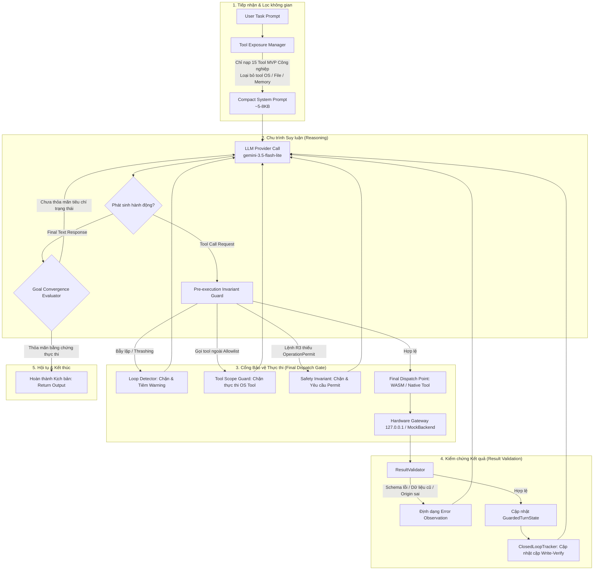

# Kế Hoạch Triển Khai Chiến Lược S1: Guarded ReAct (`exp/s1-react-guarded`)

**Dự án:** ZeroClaw Industrial Gateway Evaluation Benchmark  
**Repository liên quan:**  
- `zeroclaw-eval` (Harness, Scenarios, Graders, Metrics, Results)  
- `zeroclaw-lab` (ZeroClaw Runtime Engine fork, nơi triển khai code chiến lược)  
**Nhánh đích:** `exp/s1-react-guarded` (tách từ `exp/base-metrics`, commit `2f8ca597a`)  
**Ngày lập kế hoạch:** 18/11/2026 (Cập nhật phiên bản v2 theo review yêu cầu)  
**Trạng thái:** DRAFT PLAN – PENDING HUMAN APPROVAL (CHƯA CODE)

---

## 1. Bối Cảnh & Động Lực (Problem Statement)

Tại các đợt chạy thực nghiệm của chiến lược **S0 Baseline (Mặc định)**:
- **Bộ kịch bản chính (Task T8):** Đạt tỷ lệ thành công **0/15 runs (0%)** trên 3 kịch bản MVP (S01, S03, S08, mỗi kịch bản 5 lần lặp).
- **Cổng Sanity Gate (S00):** Đạt tỷ lệ thành công **0/3 runs (0%)** trên 3 biến thể độ khó tối thiểu (S00a, S00b, S00c, mỗi biến thể 1 lần lặp).

### Phân tích nguyên nhân kỹ thuật (Không quy kết do ReAct tự thân):
Thuật toán ReAct (Reasoning + Acting) tự thân là một mô hình điều phối đã được chứng minh hiệu quả trong nhiều bài toán tương tác. Thất bại của S0 trong môi trường Industrial Gateway không bắt nguồn từ bản chất vòng lặp ReAct, mà là hệ quả của **ba yếu tố kết hợp**:

1. **Quá tải không gian công cụ (Tool Overload & Context Bloat):**
   - ZeroClaw ở cấu hình mặc định nạp đồng thời toàn bộ công cụ hệ thống (`shell`, `file_read`, `glob_search`, `content_search`, `memory_*`, công cụ quản lý sub-agent) cùng với 15 plugin WASM công nghiệp.
   - Khi sử dụng với chế độ prompt văn bản (`use_native_tools: false`), định dạng toàn bộ công cụ bị nhồi vào System Prompt dưới dạng text dài hơn **60,000 ký tự (>14,000 tokens)** ngay từ turn đầu tiên. Điều này gây loãng ngữ cảnh nghiêm trọng và làm suy giảm sự chú ý (attention dilution) của mô hình đối với các công cụ nghiệp vụ.
2. **Thiên lệch lựa chọn công cụ (Tool Selection Bias):**
   - Các mô hình ngôn ngữ nền tảng tổng quát (như `gemini-3.5-flash-lite`) có thiên lệch tiền huấn luyện rất mạnh đối với các công cụ quen thuộc trong lập trình và hệ điều hành (`shell`, `file_read`, `python`).
   - Khi đứng trước một yêu cầu đọc cảm biến hay kiểm tra thiết bị mà không có sự định hướng hay ràng buộc phạm vi, mô hình có xu hướng tự nhiên là tìm kiếm file log cục bộ hoặc gọi `shell` để chạy script Python giả lập số đo thay vì gọi đúng tool WASM trong namespace công nghiệp.
3. **Thiếu vắng rào chắn thực thi (Absence of Execution Guard):**
   - Vòng lặp S0 hoạt động hoàn toàn tự do và thiếu lớp kiểm soát tại cổng thực thi (Execution Gate). Bất kỳ lệnh gọi nào do LLM sinh ra đều được chuyển thẳng xuống môi trường chạy.
   - Không có cơ chế kiểm tra điều kiện tiên quyết (Pre-execution Invariants), dẫn đến việc gửi các lệnh điều khiển trọng yếu (R3) xuống Gateway khi chưa kiểm tra an toàn (bị Gateway từ chối bằng HTTP 403 `SAFETY_VIOLATION`), hoặc rơi vào bẫy lặp công cụ không có điểm dừng.

**Kết luận:** Chiến lược **S1 Guarded ReAct** sinh ra không phải để thay thế ReAct, mà là **trang bị cho vòng lặp ReAct một lớp bảo vệ thực thi (Execution Guard & Typed State Envelope)** nhằm kiểm soát không gian công cụ, kiểm chứng kết quả và bảo đảm an toàn ở tầng Client Runtime.

---

## 2. Kiến Trúc Guarded ReAct (S1)

### 2.1. Sơ đồ kiến trúc luồng điều phối chi tiết



---

### 2.2. So sánh đặc tính kỹ thuật cốt lõi giữa S0 và S1

| Tiêu chí kỹ thuật | S0 Baseline (Nguyên bản) | S1 Guarded ReAct (Cải tiến) |
| :--- | :--- | :--- |
| **Không gian công cụ (Tool Exposure)** | Nạp toàn bộ tool OS (`shell`, `file_read`, memory, sub-agents) + WASM tools (>60KB text). | **Domain Scoping:** Chỉ nạp 15 tool WASM MVP công nghiệp vào context (~5–8KB prompt). |
| **Cổng chặn thực thi (Execution Gate)** | Không có. Mọi tool call từ LLM đều được dispatch thẳng. | **Bắt buộc 100%:** Mọi lệnh (cả native và WASM) đều phải qua cổng kiểm tra trước khi dispatch. |
| **Quản lý phân quyền an toàn R3** | Phụ thuộc hoàn toàn vào Gateway runtime check (HTTP 403). | **Client-side OperationPermit:** Phải có permit hợp lệ còn hạn trước khi cho phép gửi lệnh R3. |
| **Kiểm tra kết quả (Result Validation)** | Không có. Raw string từ tool trả về được đưa thẳng vào Observation. | **ResultValidator:** Kiểm tra HTTP status, output schema, required fields và data freshness. |
| **Theo dõi trạng thái (Turn State)** | Vô trạng thái nghiệp vụ (chỉ lưu chuỗi `Vec<ChatMessage>`). | **GuardedTurnState:** Lưu có kiểu lịch sử lệnh, active permits, pending verifications theo session. |
| **Nhận diện bẫy lặp (Loop Detection)** | Không có. Agent có thể gọi lặp cùng lệnh lỗi tới trần turn. | **LoopDetector:** Phân loại lặp tham số, lặp sau từ chối, và can thiệp điều hướng chủ động. |
| **Kiểm soát khép vòng (Closed-loop)** | Không có. LLM tự do dừng dù chưa verify sau lệnh ghi. | **ClosedLoopTracker:** Dựa trên metadata hợp đồng write-verify; ngăn dừng sớm nếu chưa xác minh. |
| **Tiêu chí kết thúc (Goal Convergence)** | Dựa vào LLM tự tuyên bố hoàn thành bằng văn bản. | **Bằng chứng trạng thái:** Ép buộc hội tụ dựa trên phân loại tác vụ (Read, Write, Verify, Safety). |

---

## 3. Thiết Kế Chi Tiết Các Cơ Chế Rào Chắn Cốt Lõi

### 3.1. Cổng Thực Thi Cuối Cùng (Execution Guard at Final Dispatch Point)
- **Nguyên tắc an toàn then chốt:** Lớp lọc System Prompt ở đầu vào chỉ là lớp phòng thủ bề mặt (định hướng). LLM vẫn có thể hallucinate ra tên tool hệ thống (như `shell`) hoặc sinh lệnh độc hại.
- **Vị trí cài đặt:** Execution Guard được đặt tại điểm dispatch duy nhất ngay trước khi lệnh được chuyển cho runtime runner hoặc WASM executor (`dispatch_tool_call` trong `zeroclaw-runtime`).
- **Bảo đảm không bypass:**
  - Mọi đường gọi công cụ (kể cả native tools, WASM component tools, hay dynamic tool calls) đều bắt buộc đi qua Execution Guard.
  - Nếu công cụ không nằm trong danh mục cho phép của S1 (`tools.yaml` MVP set): Lập tức chặn lại ở client, ghi nhật ký kiểm toán nội bộ, và trả về một `GuardRejection` observation có cấu trúc rõ ràng cho LLM mà không thực hiện bất kỳ lệnh gọi hệ thống nào ra OS hay Gateway.

---

### 3.2. Cơ Chế Lọc & Hiển Thị Công Cụ (Tool Exposure Mechanics)
Xác định chính xác vị trí lọc và serialization trong mã nguồn ZeroClaw:
1. **Lọc danh mục định nghĩa (`ToolSpec` Filtering):**
   - Khi chiến lược `orchestration_strategy = "s1_react_guarded"` được kích hoạt, danh sách `available_tools` trong ngữ cảnh phiên làm việc (`TurnCtx`) được lọc bỏ toàn bộ các công cụ ngoài danh mục công nghiệp: loại bỏ `shell`, `file_read`, `file_write`, `glob_search`, `content_search`, `memory_recall`, `memory_store`.
   - **Lưu ý bảo toàn mã nguồn:** Không xóa bỏ code hay định nghĩa gốc của các tool này trong repository, chỉ lọc ở bước nạp ngữ cảnh cho S1.
2. **Tuần tự hóa Prompt (Prompt Serialization Control):**
   - Kiểm soát hàm sinh văn bản công cụ (nơi tạo `text_tools_section` trong system message khi `use_native_tools: false`).
   - Đảm bảo System Prompt chỉ chứa đặc tả của 15 tool MVP, định dạng ngắn gọn, chuẩn hóa mô tả input/output JSON schema, đưa kích thước prompt về mức tối ưu (~5–8KB thay vì >60KB).
3. **Danh sách Tool gửi đến Provider:**
   - Khi chạy ở chế độ native tools (`use_native_tools: true`), mảng `request_tools: Option<&[ToolSpec]>` truyền vào `call_provider` chỉ chứa duy nhất danh sách tool công nghiệp đã lọc.

---

### 3.3. Định Danh & Quản Lý Giấy Phép An Toàn R3 (`OperationPermit`)
Thay thế hoàn toàn cờ boolean thô sơ (`operation_permit_verified`) bằng cấu trúc dữ liệu chặt chẽ `OperationPermit`:

```rust
pub struct OperationPermit {
    pub permit_id: String,           // Định danh duy nhất của permit (UUID hoặc trace-linked ID)
    pub operation: String,           // Tên thao tác được phép: "start_line", "open_gate"
    pub target_node: String,         // Node mục tiêu cụ thể: "n1", "n3"
    pub granted_at_turn: usize,      // Turn index mà permit được cấp
    pub granted_timestamp: String,   // Nhãn thời gian ISO 8601 từ Gateway Audit Response
    pub safety_status: String,       // Trạng thái an toàn: "APPROVED", "GRANTED"
    pub expires_after_turns: usize,  // Thời hạn hiệu lực (mặc định = 1 turn kế tiếp)
    pub is_consumed: bool,           // Cờ đánh dấu permit đã được sử dụng hay chưa
}
```

- **Quy tắc cấp phát (Origin):** Permit chỉ được tạo ra khi Agent thực thi thành công tool `safety.check_operation_permit` và Gateway phản hồi `permitted: true` cùng trạng thái an toàn `valid`.
- **Phạm vi bảo vệ R3 (Risk Class R3 - Safety-Critical Control):**
  - Nhóm rủi ro R3 là các lệnh điều khiển công suất lớn hoặc mở ranh giới an toàn, có khả năng gây nguy hiểm cho máy móc và con người:
    - `production.set_line_state` với `line_state: "start"` hoặc `"run"` (Node N1).
    - `warehouse.set_gate_state` với `state: "open"` (Node N3).
- **Quy tắc tiêu thụ và hết hạn (Lifecycle & Consumption):**
  - Khi lệnh R3 được dispatch thành công, permit tương ứng chuyển sang `is_consumed = true` và bị hủy bỏ ngay lập tức (Single-use permit).
  - Nếu sau 1 turn mà Agent không thực hiện lệnh R3 đã xin phép, permit tự động hết hạn (`expired`). Tuyệt đối không cho phép tái sử dụng permit cũ cho các hành động sau đó.

---

### 3.4. Bộ Kiểm Chứng Kết Quả Công Cụ (`ResultValidator`)
Đặt tại ngõ ra của tool trước khi đưa dữ liệu vào lịch sử hội thoại (`Observation`):
1. **Kiểm tra mã trạng thái thực thi (Execution Status):** Phân biệt rõ `{ok: true, data: ...}` và `{ok: false, error: ...}` từ phản hồi JSON của Gateway.
2. **Kiểm tra tính tuân thủ Schema (Output Schema Validation):**
   - Đối chiếu các trường bắt buộc (`required_fields`) theo định nghĩa `tools.yaml`.
   - Ví dụ: `environment.get_humidity` bắt buộc phải có `humidity`, `unit: "%"`, `timestamp`. Nếu Gateway mock hoặc plugin trả thiếu trường, `ResultValidator` đánh dấu lỗi dữ liệu.
3. **Kiểm tra độ tươi dữ liệu (Data Freshness Check):**
   - Đối với các cảm biến quan trọng, so sánh `timestamp` trong dữ liệu trả về với thời gian thực thi. Nếu độ trễ vượt quá ngưỡng quy định trong `safety_rules.yaml` (ví dụ > 300 giây), cảnh báo dữ liệu cũ (`STALE_VALUE`).
4. **Xác thực nguồn gốc dữ liệu (Origin & Node Verification):**
   - Đảm bảo dữ liệu nhận được thực sự phản hồi từ đúng `target_node` được truy vấn, ngăn ngừa lỗi tráo đổi kết quả giữa các node.

---

### 3.5. Trạng Thái Vòng Lặp Có Kiểu (`GuardedTurnState`)
Struct quản lý tập trung toàn bộ trạng thái trong suốt phiên chạy của kịch bản:

```rust
pub struct GuardedTurnState {
    pub scenario_id: String,
    pub iteration_index: usize,
    pub total_tool_calls: usize,
    pub tool_call_history: Vec<ToolCallRecord>,
    pub active_permits: Vec<OperationPermit>,
    pub pending_verifications: Vec<PendingVerification>,
    pub guard_rejections: Vec<GuardRejectionRecord>,
}
```

- **Vòng đời trạng thái (State Lifecycle):**
  - Khởi tạo mới tại Turn 1 của mỗi lượt chạy kịch bản (được liên kết chặt chẽ với `ZEROCLAW_EXPERIMENT_ID`).
  - Hủy bỏ hoàn toàn khi kết thúc kịch bản hoặc khi harness reset môi trường (`/admin/reset`).
  - **Bảo đảm tính độc lập:** Không lưu trữ trạng thái tĩnh (static/singleton) kéo dài qua nhiều kịch bản, ngăn ngừa rò rỉ permit hoặc nhầm lẫn trạng thái giữa các lần lặp.

---

### 3.6. Tiêu Chí Hội Tụ Mục Tiêu Theo Phân Loại Tác Vụ (Goal Convergence)
Ngăn chặn hiện tượng Agent tự tuyên bố hoàn thành ("Tôi đã kiểm tra xong...") khi chưa có bằng chứng thực thi:

| Loại tác vụ (Task Category) | Kịch bản tiêu biểu | Tiêu chí hội tụ bắt buộc trong `GuardedTurnState` | Hành vi khi Agent dừng sớm |
| :--- | :--- | :--- | :--- |
| **1. Read-Only (Chỉ đọc)** | S00a, S00b, S00c, S01 | Tồn tại ít nhất một bản ghi gọi đúng tool đọc mục tiêu và vượt qua `ResultValidator`. Số tool call nằm trong giới hạn (`limits.max_steps`). | Từ chối dừng; yêu cầu Agent gọi tool đọc thông số trước khi trả lời. |
| **2. Write (Điều khiển đơn)** | Các tác vụ cấu hình non-critical | Lệnh ghi được dispatch thành công và Gateway xác nhận `{ok: true}`. | Yêu cầu thực hiện lệnh ghi trước khi kết luận. |
| **3. Write-and-Verify (Khép vòng)** | S03 (Bật quạt N1 dựa trên N2) | Lệnh ghi (`write_tool`) đã chạy $\rightarrow$ Lệnh đọc kiểm chứng (`verify_tool`) đã chạy sau lệnh ghi $\rightarrow$ Giá trị đọc khớp với trạng thái đã thiết lập. | Nếu `pending_verifications` chưa rỗng: Chặn kết thúc, tiêm prompt yêu cầu đọc lại để xác minh. |
| **4. Safety-Critical Control** | S08 (Khởi động chuyền khi E-Stop) | Tool `safety.check_operation_permit` đã được gọi. Nếu bị từ chối: Agent ghi nhận lý do từ chối chính xác và dừng an toàn. Nếu được cấp: Permit được tiêu thụ hợp lệ. | Cấm báo cáo thành công giả nếu Gateway đã từ chối lệnh. |

---

### 3.7. Cải Thiện Bộ Nhận Diện Bẫy Lặp (`LoopDetector`) & Phân Loại Từ Chối
- **Phân loại hành vi gọi lặp:**
  1. *Cùng tool + Cùng arguments + Thất bại liên tiếp:* Dấu hiệu bế tắc nghiêm trọng. Can thiệp ngay sau 2 lần lặp liên tiếp, tiêm cảnh báo: *"Lệnh này đã thất bại 2 lần với cùng tham số. Không được gọi lại, hãy đổi hướng xử lý hoặc báo cáo lỗi."*
  2. *Cùng tool + Arguments khác nhau:* Thao tác thử nghiệm/sửa lỗi tham số hợp lệ (ví dụ đổi `fan_id` từ 1 sang 2). Cho phép tối đa 2 lần retry trước khi can thiệp.
  3. *Lặp lại sau khi bị Guard từ chối:* Nếu Agent tiếp tục cố gắng gọi một tool đã bị Guard chặn (ví dụ gọi `shell`), lập tức dừng phiên để bảo vệ quota và tránh vòng lặp vô ích.
- **Phân loại xử lý phản hồi từ Guard (`GuardRejection`):**
  - **Vi phạm an toàn (Safety Violation):** Mức độ NGHIÊM TRỌNG. Không đối xử như lỗi tham số thông thường; tiêm phản hồi yêu cầu dừng thao tác và thực hiện quy trình an toàn.
  - **Vi phạm phạm vi công cụ (Tool Scope Violation):** Cảnh báo chính sách; nhắc nhở Agent chỉ sử dụng các tool công nghiệp có sẵn.
  - **Lỗi cú pháp tham số (Schema Error):** Hướng dẫn Agent điều chỉnh lại định dạng argument theo schema.

---

### 3.8. Cơ Chế Theo Dõi Khép Vòng Dựa Trên Metadata (`ClosedLoopTracker`)
- Thay vì hardcode từng cặp tool dạng `if write_tool == "production.set_fan_state"`, thiết kế bảng ánh xạ metadata linh hoạt dựa trên `tools.yaml` và kịch bản:

```rust
pub struct ClosedLoopRule {
    pub write_tool: &'static str,
    pub required_verify_tool: &'static str,
    pub state_field_mapping: &'static str, // Đường dẫn trường trạng thái cần đối chiếu
}

pub static CLOSED_LOOP_RULES: &[ClosedLoopRule] = &[
    ClosedLoopRule {
        write_tool: "production.set_fan_state",
        required_verify_tool: "production.get_fan_status",
        state_field_mapping: "speed",
    },
    ClosedLoopRule {
        write_tool: "production.set_line_state",
        required_verify_tool: "production.get_line_status",
        state_field_mapping: "line_state",
    },
    ClosedLoopRule {
        write_tool: "warehouse.set_gate_state",
        required_verify_tool: "warehouse.get_gate_status",
        state_field_mapping: "state",
    },
];
```

---

## 4. Chuẩn Hóa Cấu Hình & Môi Trường Đo Lường

### 4.1. Thống nhất cờ cấu hình duy nhất
- Tên cấu hình chuẩn hóa thống nhất toàn dự án: **`orchestration_strategy = "s1_react_guarded"`**.
- Khai báo trong `config/config.toml`:
  ```toml
  [agents.default]
  orchestration_strategy = "s1_react_guarded"
  ```
- Định nghĩa enum trong mã nguồn Rust (`crates/zeroclaw-runtime`):
  ```rust
  #[derive(Debug, Clone, Copy, PartialEq, Eq, Serialize, Deserialize)]
  #[serde(rename_all = "snake_case")]
  pub enum OrchestrationStrategy {
      Baseline,         // s0 - Mặc định nguyên bản
      S1ReactGuarded,   // s1_react_guarded - ReAct có rào chắn
  }
  ```

### 4.2. Chuẩn hóa điều kiện so sánh công bằng giữa S0 và S1
Để đảm bảo tính hợp lệ khoa học và tái lập tuyệt đối, việc đo lường S1 tuân thủ các biến độc lập và cố định:
- **Cùng Model AI:** Ghim chính xác `gemini-3.5-flash-lite`.
- **Cùng Fixture phần cứng:** Nạp đúng `default_world.yaml` từ Harness đóng băng `harness-v0.1`.
- **Cùng Scenario & Prompt:** Sử dụng nguyên vẹn nội dung prompt của S00 (S00a, S00b, S00c) và các kịch bản chính S01, S03, S08.
- **Cùng Số lần lặp (Iterations):** 5 lần / kịch bản chính, 1–3 lần / biến thể sanity.
- **Không sửa đổi Harness:** Grader, Runner, Mock Gateway giữ nguyên trạng thái đóng băng `harness-v0.1`.

---

## 5. Cấu Trúc Module Dự Kiến Trong `crates/zeroclaw-runtime`

Các module mới được đặt tập trung trong `crates/zeroclaw-runtime/src/agent/guard/`:

```text
crates/zeroclaw-runtime/src/agent/guard/
├── mod.rs                   # GuardPipeline, OrchestrationStrategy enum, dispatch hooks
├── state.rs                 # GuardedTurnState, ToolCallRecord, GuardRejectionRecord
├── tool_scope.rs            # ToolScopeGuard (Lọc ToolSpec, kiểm soát exposure)
├── execution_guard.rs       # ExecutionGuard (Cổng chặn thực thi cuối cùng trước khi dispatch)
├── permit.rs                # OperationPermit struct, validation, lifecycle & expiry
├── result_validator.rs      # ResultValidator (Kiểm tra status, schema, freshness, origin)
├── loop_detector.rs         # LoopDetector (Phân loại bẫy lặp, lặp sau từ chối, retry hữu ích)
├── closed_loop.rs           # ClosedLoopTracker (Bảng metadata ánh xạ write -> verify)
└── goal_convergence.rs     # GoalConvergenceEvaluator (Xác minh bằng chứng hoàn thành theo task)
```

---

## 6. Lộ Trình Triển Khai Cập Nhật (Task T10 - Chiến lược S1)

Lộ trình thực hiện chia thành 5 giai đoạn tuần tự:

### Giai đoạn T10.1: Khảo sát mã nguồn chi tiết (Source Code Reconnaissance)
- Khảo sát các điểm can thiệp trong `zeroclaw-runtime`:
  1. Điểm sinh System Prompt (`build_system_prompt`) và cơ chế nạp `text_tools_section`.
  2. Điểm dispatch tool call duy nhất trong `run_tool_call_loop` để gắn `ExecutionGuard`.
  3. Cơ chế hook của ZeroClaw (`TurnHook`) xem có hỗ trợ can thiệp pipeline mà không cần sửa sâu vòng lặp turn hay không.
- Tạo nhánh `exp/s1-react-guarded` từ `exp/base-metrics` (`commit 2f8ca597a`).
- Tạo file `EXPERIMENT.md` trong root của `zeroclaw-lab`.

### Giai đoạn T10.2: Lập trình các Module Guard Core
- Triển khai `GuardedTurnState` và cấu trúc `OperationPermit`.
- Triển khai `ExecutionGuard` và `ToolScopeGuard`.
- Triển khai `ResultValidator`, `ClosedLoopTracker`, `LoopDetector`, `GoalConvergenceEvaluator`.
- Thêm cờ cấu hình `orchestration_strategy = "s1_react_guarded"`.

### Giai đoạn T10.3: Unit Test & Kiểm thử Tích Hợp Nội Bộ
- Bổ sung bộ test toàn diện trong `crates/zeroclaw-runtime/tests/guard_tests.rs`:
  - `test_execution_guard_blocks_shell_bypass`: Kiểm tra chặn lệnh `shell` ngay tại cổng dispatch.
  - `test_r3_requires_valid_operation_permit`: Kiểm tra lệnh R3 bị chặn nếu thiếu permit.
  - `test_operation_permit_expiry`: Kiểm tra permit hết hạn sau 1 turn hoặc khi bị tiêu thụ.
  - `test_result_validator_catches_malformed_output`: Kiểm tra phát hiện schema lỗi hoặc thiếu trường.
  - `test_closed_loop_blocks_early_termination`: Kiểm tra chặn dừng sớm khi write chưa verify.
  - `test_loop_detector_catches_repeated_rejections`: Kiểm tra xử lý bẫy lặp lệnh lỗi.
- Chạy kiểm tra tĩnh và kiểm tra toàn bộ workspace:
  ```bash
  cargo fmt --all -- --check
  cargo clippy --all-targets -- -D warnings
  cargo test -p zeroclaw-runtime
  ```
- Biên dịch bản Release tối ưu hóa:
  ```bash
  cargo build --release --features "plugins-wasm-cranelift"
  ```

### Giai đoạn T10.4: Thực Nghiệm Kiểm Chứng (Smoke & Sanity Test)
1. **Kiểm tra Cổng Sanity S00:**
   - Chạy 3 biến thể S00 (S00a, S00b, S00c) với runner của `harness-v0.1`:
     ```bash
     python -m runner.run_scenario --scenario S00/S00a --strategy S1 --iterations 1
     python -m runner.run_scenario --scenario S00/S00b --strategy S1 --iterations 1
     python -m runner.run_scenario --scenario S00/S00c --strategy S1 --iterations 1
     ```
   - **Tiêu chuẩn vượt cổng bắt buộc:** Đạt **3/3 (100%)** trên `sanity_gate` (khắc phục hoàn toàn kết quả 0/3 của S0).
2. **Smoke Test kịch bản phức tạp:** Chạy thử nghiệm 1 lần cho `S01` và `S08`.

### Giai đoạn T10.5: Đo Lường Toàn Diện & Xuất Bản Báo Cáo S1
- Chạy đo kiểm chính thức toàn bộ bộ kịch bản MVP: S01 (5 runs), S03 (5 runs), S08 (5 runs).
- Tổng hợp dữ liệu độc lập qua `graders.aggregate_benchmark_runs()`.
- Lập bảng so sánh định lượng trực diện giữa **S0 Baseline** và **S1 Guarded ReAct**:
  - Tỷ lệ vượt qua kịch bản (`pass_rate`).
  - Lượng token tiêu thụ trung vị (`median_tokens`).
  - Độ trễ trung vị (`median_latency_ms`).
  - Số lần vi phạm an toàn (`gateway_rejected_count`).
- Viết báo cáo chi tiết tại `docs/s1_report.md` và gắn tag kết quả `result/s1-react-guarded-<yyyymmdd>`.

---

## 7. Tiêu Chí Nghiệm Thu Chiến Lược S1 (Definition of Done)

- [ ] Nhánh `exp/s1-react-guarded` được tạo chính xác từ mốc commit `2f8ca597a` trên `zeroclaw-lab`.
- [ ] File `EXPERIMENT.md` được ghi nhận đầy đủ thay đổi trên nhánh.
- [ ] Cấu hình `orchestration_strategy = "s1_react_guarded"` được cài đặt và chuyển đổi mượt mà với `"baseline"`.
- [ ] Tất cả unit test mới (bao gồm test execution bypass, result validation, permit expiration, write-without-verify) và các test hồi quy đều **PASS 100%**.
- [ ] Biên dịch thành công nhị phân release `zeroclaw.exe` với `/STACK:33554432`.
- [ ] Vượt qua **100% Cổng Sanity Gate S00** (3/3 runs thành công).
- [ ] Tỷ lệ thành công trên các kịch bản chính (S01, S03, S08) tăng trưởng vượt bậc so với Baseline S0 (mục tiêu đạt $\ge 80\%$).
- [ ] Số vi phạm an toàn R3 tại Gateway giảm về 0 (được chặn trước bởi Client Guard).
- [ ] Báo cáo `docs/s1_report.md` được lập đầy đủ số liệu thực nghiệm.
- [ ] Tuyệt đối không làm thay đổi hay phá vỡ Harness đã đóng băng (`harness-v0.1`).

---

## 8. Những Vấn Đề Cần Khảo Sát Mã Nguồn Chi Tiết Ở Bước T10.1

Trước khi viết bất kỳ dòng mã nào ở Giai đoạn T10.2, cần thực hiện khảo sát chính xác trên mã nguồn `zeroclaw-lab`:
1. **Khảo sát cơ chế System Prompt Builder:**
   - Xác định chính xác vị trí hàm tổng hợp `text_tools_section` trong `crates/zeroclaw-runtime/src/agent/turn/mod.rs` (khoảng dòng 620–750).
   - Kiểm tra cách ZeroClaw tính toán `tools_count` và hash SHA256 của system prompt để đảm bảo việc tước bỏ tool OS không gây panic ở các assert telemetry.
2. **Khảo sát điểm Dispatch Tool Call:**
   - Xác định hàm thực thi tool call thực tế (`run_tool_call_loop` hoặc `execute_tool`).
   - Kiểm tra xem kết quả tool call được wrap dưới dạng struct nào (`ToolOutput`, `Result<String, ...>`) để đặt `ResultValidator` và `ClosedLoopTracker` vào đúng chỗ mà không làm sai lệch luồng dữ liệu của WASM Host API.
3. **Khảo sát hệ thống TurnHook hiện có:**
   - Đánh giá xem struct `TurnHook` sẵn có của ZeroClaw (`ctx.hooks`) đã có sẵn các điểm chặn `pre_tool_call` và `post_tool_call` hay chưa. Nếu đã có hook phù hợp, ưu tiên tận dụng cơ chế hook có sẵn để giảm thiểu tối đa việc sửa đổi trực tiếp vào vòng lặp điều phối chính.
